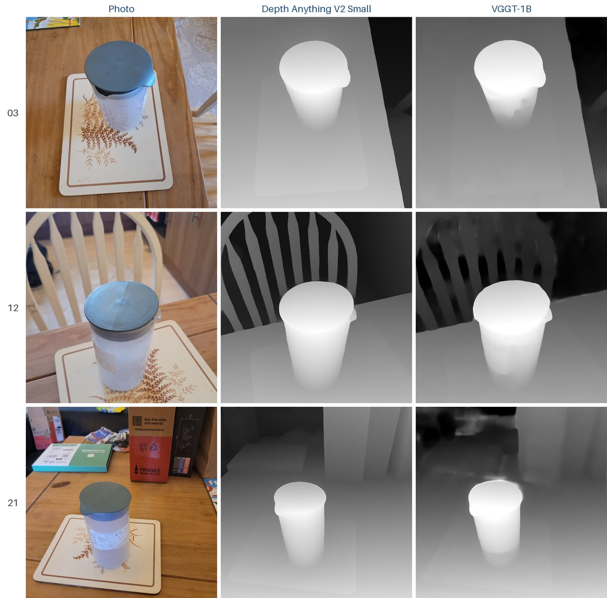

# 3D on a Budget

Final-year project for CS3D661, BSc Computer Science, University of South Wales.

The question is how much of a modern learned 3D reconstruction pipeline can run on cheap hardware, and what that costs in time and quality. I take ordinary phone photos of a small scene and run two kinds of model on them:

- Depth Anything V2 Small predicts a relative depth map from a single photo.
- VGGT-1B takes all the photos at once and predicts camera poses, depth maps and a point cloud.

The plan is to measure each model on a free Kaggle GPU, a laptop CPU, a Raspberry Pi 5 and a Raspberry Pi 5 with a Hailo-8 accelerator, wherever the model fits. The VGGT point cloud from the GPU will be the reference that the cheaper results are compared against.

## Results so far

Scene 1 is 23 photos of a jug on a placemat. Full numbers and figures are in [results/2026-10-20_scene1](results/2026-10-20_scene1/).

| Model | Hardware | Time per photo |
|---|---|---:|
| VGGT-1B | Kaggle, Tesla T4 GPU | 0.77 s (17.67 s for all 23 in one pass) |
| Depth Anything V2 Small | Laptop CPU, Intel Core Ultra 9 185H | 0.72 s |
| Depth Anything V2 Small | Raspberry Pi 5 | next |
| Depth Anything V2 Small | Raspberry Pi 5 + Hailo-8 | planned |



## Next

- Run Depth Anything V2 Small on the Raspberry Pi 5, then on the Hailo-8.
- Turn the Depth Anything depth maps into point clouds using the VGGT cameras, align them to the VGGT cloud with ICP and measure the difference with Chamfer distance.
- More scenes, and at least three timing runs for every measurement.

## Repository

| Path | Contents |
|---|---|
| `depth_single.py` | Depth Anything V2 Small on one photo |
| `depth_batch.py` | Depth Anything V2 Small on a folder of photos, with per-photo timing |
| `kaggle/bootstrap.ipynb` | Clones this repo into a Kaggle session |
| `kaggle/vggt_scene1.ipynb` | VGGT-1B on Kaggle: timing, point cloud and cameras |
| `notes/` | Supervisor meeting notes |
| `results/` | One folder per experiment |

## Running

On a laptop (CPU only):

```sh
python -m venv .venv
source .venv/bin/activate
pip install torch --index-url https://download.pytorch.org/whl/cpu
pip install -r requirements.txt
python depth_batch.py
```

Put the photos in `data/scene1/`. Depth maps are written to `outputs/scene1/`. Neither folder is tracked.

On Kaggle: import `kaggle/vggt_scene1.ipynb`, turn on a GPU and internet access, and add the photos as a dataset. The notebook clones the official [VGGT repository](https://github.com/facebookresearch/vggt) and downloads the weights from Hugging Face.

## Models

- [Depth Anything V2 Small](https://huggingface.co/depth-anything/Depth-Anything-V2-Small-hf): Apache-2.0.
- [VGGT-1B](https://huggingface.co/facebook/VGGT-1B): non-commercial licence. The weights are downloaded at run time and are not stored here.
