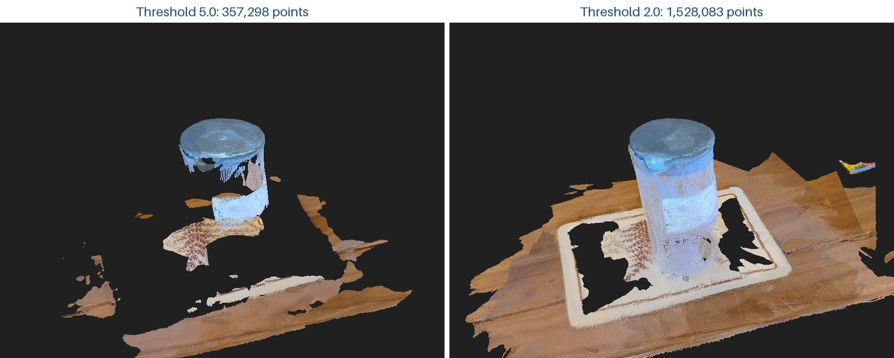

# 3D on a Budget

Final-year project for CS3D661, BSc Computer Science, University of South Wales.

The question is how much of a modern learned 3D reconstruction pipeline can run on cheap hardware, and what that costs in time and quality. I take ordinary phone photos of a small scene and run three methods on them, from cheapest to most expensive:

- Depth Anything V2 Small predicts a relative depth map from a single photo.
- VGGT-1B takes all the photos at once and predicts camera poses, depth maps and a point cloud.
- 3D Gaussian Splatting, trained from the VGGT cameras, optimises the scene for minutes instead of seconds.

Speed and memory are measured on a free Kaggle GPU, a laptop CPU, an NVIDIA Jetson Nano and a Raspberry Pi 5 with and without a Hailo-8 accelerator, wherever each model fits. The Gaussian Splatting reconstruction is the quality reference: it is scored on photos held out from training, and the cheaper results are compared against it.

## Results so far

Scene 1 is 23 photos of a jug on a placemat. Full numbers and figures are in [results/2026-10-20_scene1](results/2026-10-20_scene1/).

| Model | Hardware | Time per photo |
|---|---|---:|
| VGGT-1B | Kaggle, Tesla T4 GPU | 0.77 s (17.67 s for all 23 in one pass) |
| Depth Anything V2 Small | Laptop CPU, Intel Core Ultra 9 185H | 0.72 s |
| Depth Anything V2 Small | Raspberry Pi 5 | next |
| Depth Anything V2 Small | Jetson Nano | next |
| Depth Anything V2 Small | Raspberry Pi 5 + Hailo-8 | planned |
| VGGT-1B + 3D Gaussian Splatting | Kaggle, Tesla T4 GPU | next |




## Next

- Train 3D Gaussian Splatting on Kaggle from the VGGT cameras, hold out a few photos and measure PSNR and SSIM.
- Run Depth Anything V2 Small on the Raspberry Pi 5 and the Jetson Nano, then on the Hailo-8.
- Turn the Depth Anything depth maps into point clouds using the VGGT cameras, align them to the VGGT cloud with ICP and measure the difference with Chamfer distance.
- More scenes, and at least three timing runs for every measurement.

## Files

- `depth_single.py`: Depth Anything V2 Small on one photo
- `depth_batch.py`: the same on a folder of photos, with per-photo timing
- `depth_figure.py`: the photo / Depth Anything / VGGT comparison figure
- `pointcloud_figure.py`: renders the VGGT point cloud at two confidence thresholds
- `kaggle/vggt_scene1.ipynb`: VGGT-1B on Kaggle (timing, point cloud, cameras)
- `notes/`: supervisor meeting notes
- `results/`: one folder per experiment

## Running

On a laptop (CPU only):

```sh
python -m venv .venv
source .venv/bin/activate
pip install torch --index-url https://download.pytorch.org/whl/cpu
pip install -r requirements.txt
python depth_batch.py
```

Put the photos in `data/scene1/`. Depth maps are written to `outputs/scene1/`. Neither folder is tracked.

`depth_figure.py` and `pointcloud_figure.py` also need `outputs/scene1_vggt_cameras.npz`, which the Kaggle notebook writes.

On Kaggle: import `kaggle/vggt_scene1.ipynb`, turn on a GPU and internet access, and add the photos as a dataset. The notebook clones the official [VGGT repository](https://github.com/facebookresearch/vggt) and downloads the weights from Hugging Face.

## Models

- [Depth Anything V2 Small](https://huggingface.co/depth-anything/Depth-Anything-V2-Small-hf): Apache-2.0.
- [VGGT-1B](https://huggingface.co/facebook/VGGT-1B): non-commercial licence. The weights are downloaded at run time and are not stored here.
- [gsplat](https://github.com/nerfstudio-project/gsplat) for Gaussian Splatting: Apache-2.0.
