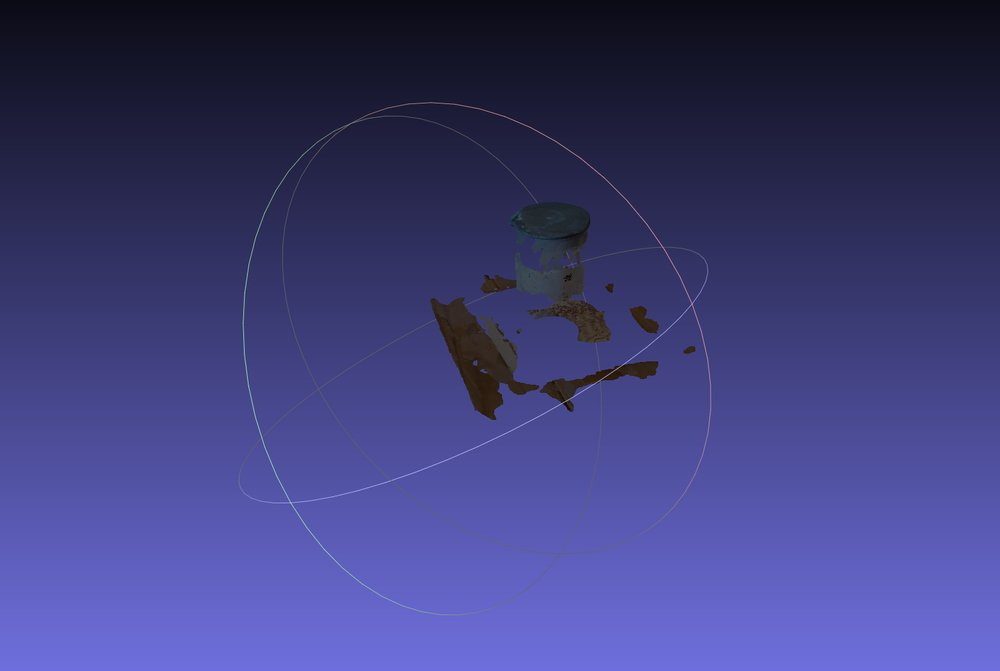
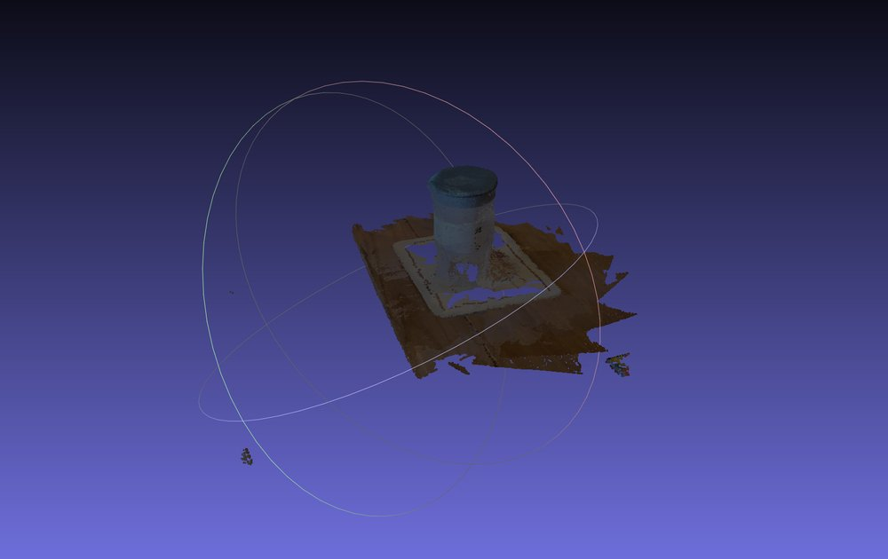

# Scene 1: jug on a placemat (20 October 2026)

23 phone photos taken in one loop around a plastic jug on a patterned placemat, mostly from the same height. The photos are 1512 × 2016 JPEG and are not stored in the repo.

## VGGT-1B on Kaggle

Tesla T4 (16 GB), float16 autocast. One forward pass over all 23 photos at 518 × 518, with `torch.cuda.synchronize()` before and after. Model loading is not included. Peak memory includes the model weights.

| Run | Inference (s) | Peak GPU memory (GB) |
|---|---:|---:|
| 1 (first in session) | 18.27 | 10.81 |
| 2 | 17.13 | 11.03 |
| 3 (new session) | 17.62 | 10.96 |
| Mean | 17.67 | 10.93 |

That is 0.77 s per photo.

Each depth map is unprojected with the predicted cameras and filtered by depth confidence. Out of 6,171,452 pixels (23 × 518 × 518):

| Confidence threshold | Points kept | Share |
|---|---:|---:|
| ≥ 5.0 (VGGT demo default) | 357,298 | 5.8 % |
| ≥ 2.0 | 1,528,083 | 24.8 % |

Notebook: [kaggle/vggt_scene1.ipynb](../../kaggle/vggt_scene1.ipynb)

## Depth Anything V2 Small on a laptop CPU

Intel Core Ultra 9 185H, WSL Ubuntu 24.04, 22 threads, PyTorch 2.14.1 (CPU). Timed with [depth_batch.py](../../depth_batch.py): each measurement is one `pipe(image)` call, which includes pre-processing and resizing the depth map back to the photo size. Model loading is not included.

| Mean (first photo excluded) | Min | Max | First photo | All 23 photos |
|---:|---:|---:|---:|---:|
| 0.72 s | 0.58 s | 0.83 s | 0.77 s | 16.55 s |

Per-photo times: [depth_anything_laptop_timing.txt](depth_anything_laptop_timing.txt)

## Depth maps

Made with [depth_figure.py](../../depth_figure.py). Bright is near. The VGGT maps are shown as 1 / depth, normalised per image. Photos and Depth Anything maps are cropped to the square that VGGT sees.

## VGGT point clouds in MeshLab

Confidence ≥ 5.0:

Confidence ≥ 2.0 (500,000 points sampled from 1,528,083):

## Notes

- The two times are not a like-for-like comparison. The models run on different hardware, and VGGT also predicts the cameras and fuses all views.
- At threshold 5.0 the jug survives but the table and mat break into patches. At 2.0 the jug is a full cylinder and the table is one flat surface.
- Both thresholds leave a hole in the plain centre of the mat and gaps around the base of the jug. Threshold 2.0 adds a few floating clusters of noise.
